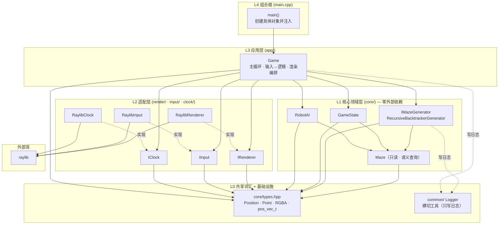

# Maze — 迷宫游戏（整洁架构教学示例）

基于 raylib 的 2D 迷宫小游戏。代码按照 **《架构整洁之道》** 的分层思想设计：核心逻辑与渲染/输入完全解耦，是一个"从零到可运行、可扩展、可替换"的入门示例。

## 功能一览

- 随机生成迷宫（递归回溯算法，解路径随生成一并记录）
- 玩家操作：方向键移动、鼠标点击并拖拽玩家
- 机器人自动通关（优先沿解路径；玩家不在解路径上时用 BFS 兜底）
- 显示/隐藏解路径、机器人加速减速、胜利提示、一键重置
- 分层架构，`core/` 不依赖任何外部库

## 目录结构与分层

| 层级 | 目录 | 职责 | 依赖 |
|------|------|------|------|
| L4 组合根 | `main.cpp` | 组装具体实现并启动游戏 | 知道所有具体类 |
| L3 应用层 | `app/` | `Game`：主循环、输入→逻辑、渲染编排 | 只依赖接口 |
| L2 适配层 | `render/` `input/` `clock/` | `IRenderer`/`IInput`/`IClock` 的 raylib 实现 | raylib + L0 共享类型 |
| L1 核心领域 | `core/` | `Maze`/生成算法/`GameState`/`RobotAI` | **零外部依赖**，仅 L0 |
| L0 共享词汇 | `core/types.hpp` | 通用值类型：`Position`/`Point`/`RGBA`/`pos_vec_t` | 仅标准库 |
| 基础设施 | `common/` | `Logger`（横切工具，被各层写日志） | 仅标准库 |

## 架构图（依赖方向）

> 箭头代表"依赖"方向。核心层（L1）不依赖任何上层与外部库；所有依赖都朝下汇聚。



## 构建与运行

环境要求：`g++`（MinGW，需在 `PATH` 中）+ raylib 6.0（已内置在 `lib/`）。

```bat
build.bat        :: 编译，生成 maze.exe
.\maze.exe       :: 运行
```

`build.bat` 等价命令：

```bat
g++ main.cpp core\*.cpp render\*.cpp input\*.cpp clock\*.cpp app\*.cpp common\*.cpp ^
-I core -I render -I input -I clock -I app -I common ^
-I .\lib\raylib-6.0_win64_mingw-w64\include\ ^
-L .\lib\raylib-6.0_win64_mingw-w64\lib\ ^
-lraylib -lopengl32 -lgdi32 -lwinmm -o maze
```

## 操作说明

| 按键 | 功能 |
|------|------|
| 方向键 `↑ ↓ ← →` | 移动玩家（按住可连续移动） |
| 鼠标左键 | 点击玩家后拖拽移动 |
| `R` | 重置（重新生成迷宫） |
| `V` | 显示 / 隐藏解路径 |
| `T` | 开启 / 关闭机器人模式 |
| 左 `Shift` / 左 `Ctrl` | 机器人加速 / 减速 |
| `Space` | 胜利后重新开始 |

## 设计要点（教学）

### 1. 依赖方向单一
`core/` 中的类型**不允许** `#include "raylib.h"`，也不允许反向依赖上层模块。检查方法：在 `core/` 里搜索 `raylib`，应为空。这让核心逻辑可以脱离渲染独立测试（例如本项目的解路径诊断程序只编译 `core/` + `common/`，无需链接 raylib）。

### 2. 依赖倒置：面向接口而非实现
- `Game` 依赖 `IRenderer` / `IInput` / `IClock` 接口，而不是 `RaylibRenderer`。
- 只有 `main.cpp`（组合根）知道"具体用什么实现"，其余代码对实现一无所知。
- 好处：换渲染后端（SDL/OpenGL）、换输入设备、换帧时钟，只需新增一个实现类并改 `main.cpp` 一处。

### 3. 组合根（Composition Root）
实例的创建与注入只发生在 `main.cpp`，游戏里不再有 `new`、不再有全局单例来传递共享状态。`Game` 通过构造函数拿到依赖（依赖注入），可测试、可替换。

### 4. 共享状态集中
`GameState` 统一持有：迷宫、解路径、玩家位置、机器人模式、胜负判定。移动规则（越界/撞墙）也在这里判定。各模块不再各自维护一份状态，也就不存在"参数隔离但状态纠缠"的问题。

### 5. 单向"建议者"模式
`RobotAI` 只根据世界状态**建议**一个移动方向（`suggest`），不直接修改玩家位置。是否执行由 `Game` 决定。这让机器人策略可以任意替换而不影响其他模块。

### 6. 最底层：共享词汇 + 横切工具
- `core/types.hpp` 是**全项目最底层的"通用词汇"**（`Position`/`Point`/`RGBA`/`pos_vec_t`）。任何层都能依赖它，而它不依赖任何人。比如 `input/` 只需要 `Point`，就只 include `types.hpp`，不必拖入整个迷宫领域。
- `Maze` 对内部 `map_t` 完全封装，只暴露**语义查询**（`isInside`/`hasWall`/`rows`/`cols`/`start`/`target`），不再提供 `cells()`。渲染器、移动、寻路都通过查询"提问"，将来换内部存储也不会影响它们。
- `common/Logger` 是**横切基础设施**：自身零项目依赖（只依赖标准库），所以即使被 `core` 调用也不会造成循环依赖或污染领域。它像一把"公共扳手"——谁都能用；若将来需要可替换的日志后端（文件/网络），再把它抽象成接口注入即可。

## 算法说明（教学）

### 递归回溯（生成迷宫 + 解路径）
从起点出发，随机选择一个未访问的邻居，打通之间的墙并前进；无路可走时回溯到上一个节点。最终得到一棵生成树（完美迷宫）。解路径即"首次到达终点时"的 DFS 栈。

> 常见坑：回溯时若先把 `current` 设为栈顶再弹出，`current` 仍是刚弹出的死胡同，会导致记录的路径出现"斜跳/未通墙"（表现为解路径拐角有缺口、机器人卡住）。正确做法：**先弹出死胡同，再把 `current` 设为新的栈顶（父节点）**。

### BFS（机器人兜底寻路）
当玩家不在解路径上时（例如手动乱走后开启机器人），用广度优先搜索在迷宫中从玩家当前位置找到一条到终点的路径，返回第一步方向。`prev` 数组记录"每个格子从哪个格子走来"，便于回溯还原整条路径。

## 扩展练习（教学）

1. **新增生成算法**：实现 `IMazeGenerator`，例如"深度优先+随机( Aldous-Broder )"或"递归分割（Recursive Division）"，然后在 `main.cpp` 换一行即可。
2. **更换渲染后端**：实现 `IRenderer`，用 SDL 或终端字符画渲染迷宫，无需改动 `core/` 与 `app/`。
3. **给机器人换策略**：实现"贪心（始终朝目标方向尝试）"等新 `RobotAI`，对比 BFS 的效果。
4. **改造 `GameState`**：增加"步数统计 / 计时 / 最佳纪录"，只动核心层，渲染层无需知道细节。
5. **为 `core/` 编写单元测试**：`GameState::tryMovePlayer`、生成算法、`RobotAI::suggest` 都是纯函数/纯逻辑，可直接测试而不需要窗口。

## 常见问题

- **解路径拐角有缺口 / 机器人中途卡住**：多半是回溯逻辑错误（见"算法说明"），可用"遍历相邻对检查 `direction_between` 与 `hasWall`"的诊断程序验证。
- **改了 `MazeConfig` 的 `rows/cols` 后起点/终点错乱**：`start/target` 不会自动跟随尺寸变化，请用带参构造 `MazeConfig(rows, cols)` 创建（会自动计算默认起点/终点），或在 `generate()` 里已加入的越界校验会直接报错而非崩溃。
- **窗口图标不显示**：图标按相对路径 `resources\maze_icon.png` 加载，需从项目根目录运行 `maze.exe`。
